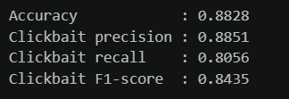
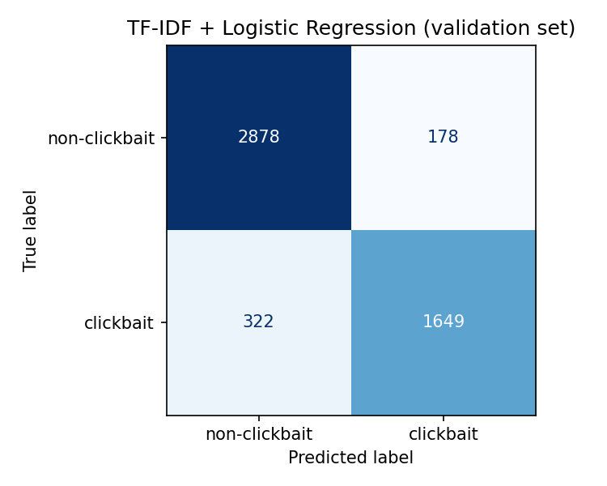
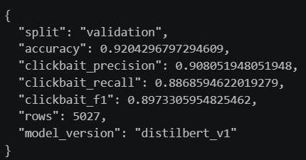
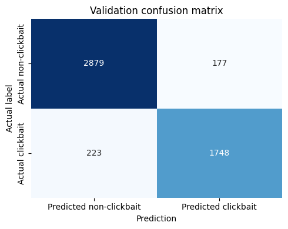

# Clickbait Headline Classifier

This project compares two approaches for classifying English news headlines as clickbait (label `1`) or non-clickbait (label `0`): a traditional TF-IDF + Logistic Regression baseline and a fine-tuned DistilBERT transformer. It includes data preparation, training, evaluation, and a small interactive prediction demo.

## Project structure

```text
csc173-midterm/
├── datasets/
│   ├── raw/                 # Original Kaggle CSVs
│   └── processed/           # Cleaned data, shared splits, and conflict report
├── notebooks/
│   ├── 01_data_prep.ipynb
│   ├── 02_tfidf_baseline.ipynb
│   ├── 03_distilbert_finetuning.ipynb
│   └── 04_demo.ipynb
├── results/
│   └── preliminary/         # Validation metric and confusion-matrix figures
└── README.md
```

The processed dataset contains 50,261 headlines. The shared stratified split contains 40,208 training, 5,027 validation, and 5,026 test examples. Dataset 2's `other` label is excluded; its `news` and `clickbait` labels are mapped to `0` and `1`.

## How to run

Google Colab is recommended, especially for DistilBERT fine-tuning. TF-IDF + Logistic Regression and data preparation can run on CPU; a GPU can speed up DistilBERT training, when available.

1. Open a notebook from `notebooks/` in Colab and run its cells from top to bottom. Colab runs one notebook at a time; the notebooks hand off data and model files through saved files.
2. Run `01_data_prep.ipynb` to regenerate the cleaned dataset and shared splits from the raw CSVs. The processed CSVs are already included, so this step can be skipped when using the existing files.
3. Run `02_tfidf_baseline.ipynb` and `03_distilbert_finetuning.ipynb` using the same train, validation, and test CSVs. Use validation results for preliminary model comparison and any model changes; reserve the test set for final evaluation.
4. Run `04_demo.ipynb` after the models are saved. It loads the fine-tuned DistilBERT model from Google Drive and prompts you to upload the TF-IDF `.joblib` artifact.

When Colab asks for CSVs, upload the matching files from `datasets/processed/`. Colab runtimes are temporary, so keep generated files and the DistilBERT model in Google Drive if they need to persist between notebook sessions. The trained model weights are not stored in this GitHub repository.

## Preliminary validation results

Both models were evaluated on the same 5,027-headline validation split. Precision, recall, and F1 are for the clickbait class.

| Model | Accuracy | Clickbait precision | Clickbait recall | Clickbait F1 |
|---|---:|---:|---:|---:|
| TF-IDF + Logistic Regression | 90.05% | 90.26% | 83.66% | 86.84% |
| Fine-tuned DistilBERT | 92.04% | 90.81% | 88.69% | 89.73% |

DistilBERT made 400 validation errors compared with 500 for TF-IDF + Logistic Regression. Its main gain was recall: it missed fewer clickbait headlines (223 false negatives versus 322), while false positives were nearly the same (177 versus 178). These are preliminary results; they show better performance on this split, but do not by themselves prove that contextual understanding caused the improvement.

## Validation figures:

### TF-IDF + Logistic Regression





### DistilBERT





## Limitations

The classifiers learn the dataset's labels and only see the headline, not the article or evidence behind its claims. They are intended for English headlines; predictions for other languages may be unreliable. A confidence percentage is a model estimate, not a verified measure of how misleading or severe a headline is.
